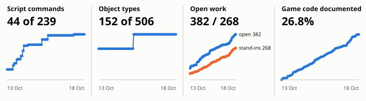

# The Chase Begins — PC port (work in progress)

This project builds a PC port of *LEGO City Undercover: The Chase Begins* (Nintendo 3DS). The goal is a port that plays exactly like the original, from start to finish. It runs on Linux first. A Windows version is planned for after the Linux version is finished.

**The game is not playable on PC yet.** What you can start today is `chase-game`, an early development runtime. It shows the start screens of the original game. After them you can play mission 1-1 from start to end in one street of the city. Mission 1-2 is partly playable. Nothing else of the game works yet. See [the project status](docs/status.md).

The game data is never part of this repository. You need your own copy of the game, dumped from your own 3DS.

## Progress

<!-- progress:start -->
| Measure | Now | What it means |
|---|---|---|
| Script commands | 50 of 239 (20.9%) | Different commands the level scripts call that the port runs. They cover 68.3% of all calls. 133 more run with a stand-in result. |
| Object types | 156 of 506 (30.8%) | Different object types in the levels that the port treats with recovered rules (collision, doors, studs). They cover 54.4% of all placed objects. |
| Game files read | 99.7% of files, 99.9% of data | Files in the game archive (12836) that the port can decode, by count and by size. |
| Open work | 484 open items, 365 stand-ins | Known gaps and temporary guesses in 27 feature areas. It has no total to reach; watch the trend. |
| Checked against the original | 316 tests, 210 recorded traces | Automatic tests, and recordings of the original game that the tests compare with. |
| Game code documented | 2443 of about 7575 (32.2%) | Functions of the game program that the notes or the source point to. The total is an estimate. |



Updated 2026-10-19, commit 9f904e3. How the numbers are measured: [docs/progress.md](docs/progress.md).
<!-- progress:end -->

## What you need

- A computer with Linux (x86_64) and a graphics card that supports OpenGL 4.6.
- About 3 GB of free disk space.
- Your own **decrypted `.cci` image** of the game. Only the European version 1.0 (title ID `00040000000AD600`) is tested. Other regions may work, because the port reads only the game's asset files, but nobody has tried them yet. More in [Getting started](docs/getting-started.md#check-your-game-file).
- A keyboard. A mouse is optional.

## Step by step

All commands go into a terminal. Run them one after the other.

**1. Get the code.**

```sh
git clone ssh://git@forgejo.zjanny.org:222/zJanny/LegoCityUndercover-TheChaseBegins-PC-Port.git
cd LegoCityUndercover-TheChaseBegins-PC-Port
```

This downloads the project into a new folder and opens it. You should see no error. Run every command below from this folder.

**2. Install the packages.** Pick the line for your Linux.

```sh
# Debian, Ubuntu, Linux Mint
sudo apt install git build-essential cmake pkg-config python3 libsdl2-dev libepoxy-dev libavformat-dev libavcodec-dev libswscale-dev libswresample-dev libavutil-dev

# Fedora
sudo dnf install git gcc-c++ cmake pkgconf-pkg-config python3 SDL2-devel libepoxy-devel ffmpeg-free-devel

# Arch, Manjaro
sudo pacman -S git base-devel cmake python sdl2 libepoxy ffmpeg
```

This installs the compiler, the build tool, Python and the libraries the game needs. Your system may ask for your password.

**3. Build the game.**

```sh
cmake -S . -B build -DCMAKE_BUILD_TYPE=RelWithDebInfo -DCHASE_BUILD_TESTS=OFF
cmake --build build -j"$(($(nproc) - 1))"
```

This compiles the program into the folder `build`. It takes a few minutes. At the end you should see `[100%] Built target chase-game`.

**4. Extract the game data from your image.** Replace `path/to/game.cci` with the path of your file. Keep the quotes if the name has spaces.

```sh
python3 tools/extract_romfs.py "path/to/game.cci" --output artifacts/romfs
```

This copies the game files out of your image into the folder `artifacts/romfs`. Your image is not changed. You should see a line like `51 files, 763156067 bytes -> artifacts/romfs`.

**5. Start the game.**

```sh
build/chase-game
```

A window opens. It shows the start screens of the original game: logos, language list, slot list and the intro movie. After the title card the level starts, and you can move the main character. Press Escape to quit.

The game saves at the same moments as the original (for example when the story saves or you collect a super brick). The file is `~/.local/share/chase/savegame.dat`; the terminal prints `save: request N written to ...` each time. To continue later, start from that file:

```sh
build/chase-game --save ~/.local/share/chase/savegame.dat --slot 0
```

You should see `save: level entry ..., studs ..., super bricks ...` in the terminal, and the level that slot was last in starts. Saving is new and incomplete: what you built or collected in a level is not stored yet.

## Controls

| Action | Keys |
|---|---|
| Menus: confirm, back | Space (A), Q (B) |
| Menus: up and down | Arrow keys or W and S |
| Walk, run and sprint | Arrow keys or W, A, S, D |
| Walk slowly | Hold Left Alt |
| Jump | Q or right mouse button |
| Punch | R |
| Use, get in a car | Space or left mouse button |
| Turn the camera | Z and C |
| Pause menu (Resume works) | Return; turn with the arrow keys or click on the lower screen |
| Quit | Escape |

All keys and how to change them: [Controls](docs/controls.md).

## If something goes wrong

- **`build/chase-game` does not exist after the build.** libepoxy or FFmpeg was not found. Install the packages of step 2 and run the two commands of step 3 again.
- **`chase-game: cannot open archive: artifacts/romfs/...`.** Run the game from the project folder, and do step 4 first.
- **The extraction says "encrypted".** Your image is still encrypted. Dump it again as a decrypted image. See [Getting started](docs/getting-started.md#check-your-game-file).
- **The extraction says a hash does not match.** The image file is damaged or incomplete. Dump it again.
- **The extraction says "output already exists".** Delete the folder `artifacts/romfs` and run step 4 again.
- **The window does not open or stays black.** Update your graphics driver. The game needs OpenGL 4.6.
- More help: [Getting started](docs/getting-started.md#problems).

## More documentation

- [Getting started](docs/getting-started.md): requirements, version check, package details, the other programs and more problems.
- [Development runtime](docs/game-runtime.md): what `chase-game` does and its options.
- [Project status](docs/status.md): what works and what does not.
- [Controls and the input laboratory](docs/controls.md)
- [Building the tools](docs/building.md), including tests
- [Extracting game data](docs/extracting-game-data.md): all extraction and conversion tools
- [Command reference](docs/commands.md)
- [Model viewer](docs/model-viewer.md), [sound test](docs/sound-test.md), [video player](docs/fmv-player.md), [debug overlay](docs/debug-overlay.md)
- [How progress is measured](docs/progress.md)
- For developers: [`CLAUDE.md`](CLAUDE.md) (rules), [the plan](docs/plans/linux-port.md), [the work log](docs/plans/linux-port.progress.md), [feature pages](docs/plans/features/README.md), [reverse-engineering notes](docs/re/README.md).
